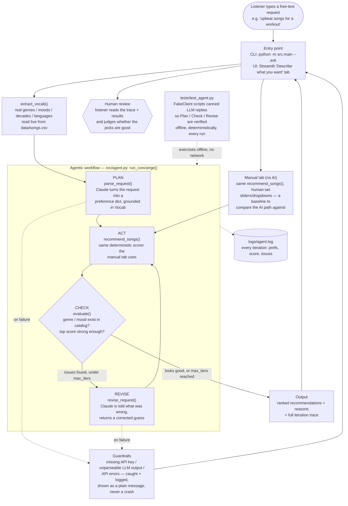

# 🎵 Music Recommender Simulation — AI Taste Concierge

## Summary

This project is a music recommender with two layers: a deterministic, rule-based scoring engine (the original Modules 1–3 project), and an **AI Taste Concierge** sitting in front of it — an agentic workflow that lets a listener describe what they want in plain English, has Claude turn that into the scorer's structured preference format, runs the scorer, and then checks its own results and self-corrects if the match looks weak. It matters because it's a small, honest demonstration of the difference between "an LLM bolted on" and AI that's actually load-bearing: the AI's output here *is* the input to the recommendation logic, the system checks its own work before showing it to anyone, and every failure mode (bad API key, bad LLM output, a request the catalog can't serve) fails safely instead of crashing or silently guessing.

---

## Original Project (Modules 1–3)

The original project is **"Music Recommender Simulation."** Its goal was to represent songs and a listener's taste profile as structured data, design a transparent scoring rule that turns that data into ranked recommendations, and reflect on where bias or unfairness could show up in a system like it. The Modules 1–3 version took a structured taste profile (`favorite_genre`, `favorite_mood`, `target_energy`, `likes_acoustic`, plus later extensions for decade/popularity/language/vocals) and scored every song in a small 18-song catalog against it with a fixed, weighted arithmetic formula — no learning, no AI, just addition and sorting, with a plain-language explanation attached to every ranked pick. That scoring engine (`src/recommender.py`) is unchanged in this upgrade; it's still the thing doing the actual ranking.

---

## Architecture Overview



The full diagram source, plus a written breakdown of each component, data flow, and the human/testing checkpoints, lives in [`diagrams/system_diagram.md`](diagrams/system_diagram.md).

In short: a free-text request goes in, gets planned into the recommender's existing preference format (grounded in the catalog's real genre/mood/decade/language values so the agent can't invent something the catalog can't serve), gets scored by the same deterministic engine the manual tab uses, gets checked by the agent against its own self-check, and — if that check finds a problem — gets revised and re-scored before anything is shown to the listener. Everything that happens is logged and surfaced in the trace, so no step is a black box.

---

## Setup Instructions

1. Create a virtual environment (optional but recommended):

   ```bash
   python -m venv .venv
   source .venv/bin/activate      # Mac or Linux
   .venv\Scripts\activate         # Windows
   ```

2. Install dependencies:

   ```bash
   pip install -r requirements.txt
   ```

3. (Optional, only needed for the AI Taste Concierge) Get an API key from [console.anthropic.com](https://console.anthropic.com/), then:

   ```bash
   cp .env.example .env
   # edit .env and paste in your key
   ```

4. Run the CLI app:

   ```bash
   python -m src.main                                     # structured demo profile, no AI, no key needed
   python -m src.main --ask "upbeat songs for a workout"  # AI Taste Concierge, needs ANTHROPIC_API_KEY
   ```

5. Or run the Streamlit front end:

   ```bash
   streamlit run app.py
   ```

   This opens a browser tab with two tabs: "Describe what you want" (the AI Taste Concierge) and "Set preferences manually" (the original rule-based scorer, no AI). If you don't have a `.env` file set up, the sidebar lets you paste an API key for that session only.

6. Run the test suite:

   ```bash
   PYTHONPATH=. pytest
   ```

   This includes `tests/test_agent.py`, which tests the AI Taste Concierge's parsing, validation, self-check, and retry logic against a fake LLM client — no `ANTHROPIC_API_KEY` or network access required, so the suite runs the same way for everyone, with or without a key.

Without a key set, `python -m src.main` (no `--ask`) and the "Set preferences manually" tab still work exactly as before — only the `--ask` / AI tab paths need the key, and they fail with a clear setup message rather than a crash if it's missing.

---

## Sample Interactions

All three runs below are real transcripts from `python -m src.main --ask "..."` against the live Anthropic API (Claude Sonnet 5.5), not fabricated output.

**1. A clean, well-specified request — resolves in one iteration**

```
Listener request: 'Something upbeat and happy, high energy, not acoustic'

Agent trace
========================================
Iteration 1: prefs={'favorite_genre': 'pop', 'favorite_mood': 'happy', 'likes_acoustic': False, 'target_energy': 0.85, 'allow_explicit': True}
   top score: 5.26
   looks good, stopping

Top Recommendations
========================================

1. Sunrise City (5.26 pts)
   - Matches your favorite genre (pop)
   - Matches your favorite mood (happy)
   - Energy closely matches your target
   - Low acousticness, matching your preference

2. Rooftop Lights (3.97 pts)
   - Matches your favorite mood (happy)
   - Energy closely matches your target
   - Low acousticness, matching your preference

3. Gym Hero (3.79 pts)
   ...
```

**2. A request the catalog can't literally serve — tests grounding**

```
Listener request: "I'm in the mood for some opera, something euphoric and grand"

Agent trace
========================================
Iteration 1: prefs={'favorite_genre': 'classical', 'favorite_mood': 'energetic', 'likes_acoustic': True, 'target_energy': 0.8, 'prefers_vocals': True, 'allow_explicit': True}
   top score: 3.665
   looks good, stopping

Top Recommendations
========================================

1. Fractal Bloom (3.67 pts)
   - Matches your favorite mood (energetic)
   - Energy closely matches your target

2. Starlit Lullaby (2.86 pts)
   - Matches your favorite genre (classical)
   - High acousticness, matching your preference
   ...
```

There's no "opera" genre or "euphoric" mood in the catalog, so the agent's `PLAN` step grounded the request to the closest real values (`classical` / `energetic`) instead of inventing a genre that would silently score zero everywhere. The self-check found both values exist in the catalog and the score was strong enough, so it stopped after one iteration.

**3. Nonsense input — tests the guardrail path, not just the happy path**

```
Listener request: 'asdkjhaskjdh random gibberish text'

Agent trace
========================================
Iteration 1: prefs={'favorite_genre': 'pop', 'favorite_mood': 'chill', 'likes_acoustic': False, 'target_energy': 0.5, 'allow_explicit': True}
   top score: 3.63
   looks good, stopping

Top Recommendations
========================================

1. Midnight Coding (3.63 pts)
   - Matches your favorite mood (chill)
   - Energy closely matches your target
   ...
```

Gibberish input didn't crash the agent or raise an unhandled exception — `parse_request()` still returned valid JSON (a neutral, middle-of-the-road guess), `validate_prefs()` sanitized it, and the scorer ran normally.

A full, guaranteed demonstration of the **self-correction** path specifically (iteration 1 guesses badly, iteration 2 fixes it) is in `tests/test_agent.py::test_run_concierge_self_corrects_on_a_weak_first_guess` — see [Testing Summary](#testing-summary) for why that's where it's reliably shown, rather than in a live transcript.

---

## Reproducible Execution Evidence

Everything below is real terminal output from this exact codebase, captured directly from a shell — not recreated or edited by hand — so the system can be graded by reading this file, without needing to watch a demo video.

### Sample command executions, inputs, and outputs

**1. Default run — no AI, no API key needed:**

```
$ python -m src.main
User profile: {'favorite_genre': 'pop', 'favorite_mood': 'happy', 'target_energy': 0.8, 'likes_acoustic': False}

Top Recommendations
========================================

1. Sunrise City (5.28 pts)
   - Matches your favorite genre (pop)
   - Matches your favorite mood (happy)
   - Energy closely matches your target
   - Low acousticness, matching your preference

2. Rooftop Lights (4.07 pts)
   - Matches your favorite mood (happy)
   - Energy closely matches your target
   - Low acousticness, matching your preference

3. Gym Hero (3.69 pts)
   - Matches your favorite genre (pop)
   - Energy closely matches your target
   - Low acousticness, matching your preference
```

**2. AI Taste Concierge — clean, well-specified input:**

```
$ python -m src.main --ask "Something upbeat and happy, high energy, not acoustic"

Listener request: 'Something upbeat and happy, high energy, not acoustic'

Agent trace
========================================
Iteration 1: prefs={'favorite_genre': 'pop', 'favorite_mood': 'happy', 'likes_acoustic': False, 'target_energy': 0.85, 'allow_explicit': True}
   top score: 5.26
   looks good, stopping

Top Recommendations
========================================

1. Sunrise City (5.26 pts)
   - Matches your favorite genre (pop)
   - Matches your favorite mood (happy)
   - Energy closely matches your target
   - Low acousticness, matching your preference

2. Rooftop Lights (3.97 pts)
   - Matches your favorite mood (happy)
   - Energy closely matches your target
   - Low acousticness, matching your preference
```

**3. AI Taste Concierge — input the catalog can't literally serve (tests grounding):**

```
$ python -m src.main --ask "I'm in the mood for some opera, something euphoric and grand"

Listener request: "I'm in the mood for some opera, something euphoric and grand"

Agent trace
========================================
Iteration 1: prefs={'favorite_genre': 'classical', 'favorite_mood': 'energetic', 'likes_acoustic': True, 'target_energy': 0.8, 'prefers_vocals': True, 'allow_explicit': True}
   top score: 3.6650000000000005
   looks good, stopping

Top Recommendations
========================================

1. Fractal Bloom (3.67 pts)
   - Matches your favorite mood (energetic)
   - Energy closely matches your target

2. Starlit Lullaby (2.86 pts)
   - Matches your favorite genre (classical)
   - High acousticness, matching your preference
```

**4. AI Taste Concierge — nonsense input (tests the guardrail path, not just the happy path):**

```
$ python -m src.main --ask "asdkjhaskjdh random gibberish text"

Listener request: 'asdkjhaskjdh random gibberish text'

Agent trace
========================================
Iteration 1: prefs={'favorite_genre': 'pop', 'favorite_mood': 'chill', 'likes_acoustic': False, 'target_energy': 0.5, 'allow_explicit': True}
   top score: 3.63
   looks good, stopping

Top Recommendations
========================================

1. Midnight Coding (3.63 pts)
   - Matches your favorite mood (chill)
   - Energy closely matches your target
```

### Reliability / guardrail results

**Missing API key — fails safely with a clear message, not a stack trace or crash:**

```
$ python -m src.main --ask "something chill for studying"   # run with no ANTHROPIC_API_KEY configured

ANTHROPIC_API_KEY is not set, so the AI Taste Concierge can't run.
Set it in your shell (export ANTHROPIC_API_KEY=sk-...) or in a .env file, then re-run with --ask. See README.md for setup steps.
exit code: 1
```

**Full automated test suite — 16/16 passing, offline, no API key or network required:**

```
$ PYTHONPATH=. pytest -v
============================= test session starts ==============================
collected 16 items

tests/test_agent.py::test_extract_vocab_matches_catalog PASSED           [  6%]
tests/test_agent.py::test_validate_prefs_fills_safe_defaults PASSED      [ 12%]
tests/test_agent.py::test_validate_prefs_clamps_out_of_range_energy PASSED [ 18%]
tests/test_agent.py::test_validate_prefs_drops_decade_not_in_catalog PASSED [ 25%]
tests/test_agent.py::test_parse_request_extracts_json_from_markdown_fence PASSED [ 31%]
tests/test_agent.py::test_parse_request_skips_a_leading_thinking_block PASSED [ 37%]
tests/test_agent.py::test_parse_request_retries_once_on_bad_json_then_succeeds PASSED [ 43%]
tests/test_agent.py::test_parse_request_raises_after_exhausting_retries PASSED [ 50%]
tests/test_agent.py::test_evaluate_flags_genre_and_mood_not_in_catalog PASSED [ 56%]
tests/test_agent.py::test_evaluate_passes_a_strong_match PASSED          [ 62%]
tests/test_agent.py::test_evaluate_does_not_flag_a_genre_that_exists_but_misses_the_top_spot PASSED [ 68%]
tests/test_agent.py::test_run_concierge_requires_a_client PASSED         [ 75%]
tests/test_agent.py::test_run_concierge_self_corrects_on_a_weak_first_guess PASSED [ 81%]
tests/test_agent.py::test_run_concierge_stops_at_max_iters_even_if_still_weak PASSED [ 87%]
tests/test_recommender.py::test_recommend_returns_songs_sorted_by_score PASSED [ 93%]
tests/test_recommender.py::test_explain_recommendation_returns_non_empty_string PASSED [100%]

============================== 16 passed in 0.03s ===============================
```

For the full human-evaluation pass/fail table (8 real interactions scored against specific criteria, including the two bugs this testing found and fixed), see [Reliability Evaluation](#reliability-evaluation) under Testing Summary.

---

## Design Decisions

- **Agentic workflow over RAG or fine-tuning.** The project already had a working, documented scoring engine (`recommend_songs`). The highest-leverage AI addition was a natural-language front door to that *existing* logic, with a check-and-retry loop — not a parallel retrieval index (there's no unstructured text corpus to retrieve from; the catalog is 18 rows of structured attributes) and not a fine-tuned model (massive overkill, and there's no training data).
- **Reuse the scorer unchanged.** `agent.py` never reimplements scoring — it calls the exact same `recommend_songs()` the manual tab uses. This keeps one source of truth for "what makes a good match" and means the AI layer can be judged purely on whether it produces good *inputs* to that scorer, not on a second, divergent ranking algorithm.
- **Ground the LLM in the catalog's real vocabulary.** Every prompt includes the actual genres/moods/decades/languages pulled live from `data/songs.csv`. This was a deliberate trade-off: it constrains the LLM's creativity (it can't recommend-by-vibe outside the catalog's own categories) in exchange for eliminating most hallucinated-preference failures before they happen, rather than catching them after the fact.
- **Self-check by catalog membership, not by "did the top result mention it."** An early version of `evaluate()` checked whether the *#1 ranked song's* reasons mentioned the stated genre/mood, and that produced a real bug (see Testing Summary) — a song can genuinely match the stated genre and still not be the overall top pick once other preferences are weighed in, since the scorer does partial credit by design. The check now asks the more precise question: does this genre/mood exist in the catalog at all.
- **Cap iterations, don't loop until perfect.** `max_iters` (default 2) is a hard ceiling. The trade-off is explicit: a request the catalog genuinely can't satisfy well will still get a weak recommendation rather than an endless retry loop — but the listener sees exactly why (the trace), which was judged better than hiding the limitation behind more (costly, still-uncertain) retries.
- **Validate and clamp, don't reject.** `validate_prefs()` never raises on bad input — out-of-range energy is clamped, unrecognized fields are dropped, missing fields get safe defaults. The trade-off is that a badly-parsed LLM reply degrades recommendation quality instead of stopping the pipeline outright; this was chosen to match the structured/manual path's existing philosophy (documented in the Modules 1–3 experiments below) of failing gracefully rather than failing loudly.
- **Streamlit for the front end, not a custom web stack.** `streamlit` was already an unused dependency in the starter `requirements.txt`, and it gets a working UI with session state, a sidebar, and two tabs in well under 150 lines — appropriate for a classroom project where the front end isn't the thing being graded on engineering depth.
- **`.env` for the key, with a Streamlit-sidebar fallback.** Keeps the key out of git (`.gitignore`) while still letting someone demo the Streamlit app without ever touching a terminal or environment variable, at the cost of a slightly less secure "paste a password into a text box" UX for that fallback path — acceptable for a local, single-user classroom demo, not something to ship broadly.

---

## Testing Summary

**Automated, offline (no API key or network required):** 16 tests across `tests/test_recommender.py` and `tests/test_agent.py`, all passing. The agent tests use a `FakeClient` that scripts canned LLM replies, so `parse_request`/`evaluate`/`revise_request`/`run_concierge` are verified deterministically — including the multi-iteration self-correction loop (`test_run_concierge_self_corrects_on_a_weak_first_guess`), validation/clamping of malformed preferences, and retry-then-raise behavior on unparseable LLM output.

**What didn't work the first time — caught by live testing, not by the mocked suite:**

1. **A real crash the tests missed.** `_call_llm_json` assumed `response.content[0]` was always the reply text. Against the real API, Claude Sonnet 5.5 sometimes returns an extended-thinking block *before* the text block, so `content[0].text` raised `AttributeError: 'ThinkingBlock' object has no attribute 'text'` on a live run — even though all 15 mocked tests were green. The mocks were wrong because they encoded an assumption about the response shape that didn't match reality. Fixed by finding the first block where `type == "text"` instead of indexing by position, and added a regression test (`test_parse_request_skips_a_leading_thinking_block`) that fakes exactly that block ordering so this can't silently regress.
2. **A misleading self-check message.** A live run with `favorite_genre="classical"` reported "No song in the catalog matches genre 'classical'" — which was false; `Starlit Lullaby` is genre `classical` and did match, it just wasn't the #1 overall pick once mood/energy/acoustic preferences were weighed in (the scorer's partial-credit design doing exactly what it's supposed to). The original `evaluate()` only looked at the top result's reasons. Fixed by checking catalog vocabulary membership directly instead, and added `test_evaluate_does_not_flag_a_genre_that_exists_but_misses_the_top_spot` to lock in the corrected behavior.

**What we learned:** a comprehensive mocked test suite proves your *logic* is correct given the response shape you assumed — it can't catch a wrong assumption about what the real API actually returns, or a self-check heuristic that's logically consistent but checking the wrong thing. Both bugs above passed every existing test and only surfaced once real output was read end-to-end. That's also why one specific claim in the Sample Interactions section is deliberately *not* a live transcript: grounding the LLM in the catalog's real vocabulary turned out to work well enough that the live `REVISE` iteration rarely fires in practice (several live attempts at a self-correction demo resolved correctly on the first try) — so the loop's second-iteration behavior is demonstrated reliably in the test suite instead of chased in production traffic.

The original rule-based scorer's own edge-case testing (case sensitivity, out-of-range energy, a genuine scoring tie, etc.) is documented separately below in [Experiments You Tried](#experiments-you-tried), since that testing predates and is independent of the AI layer.

### Reliability Evaluation

I used three of the suggested ways to test the AI layer, not just one: **automated tests** (16/16 passing, offline, listed above), **logging and error handling** (every iteration and every caught failure is written to `logs/agent.log`, detailed in Design Decisions), and **human evaluation** — I read the actual output of 8 real interactions against the live API and judged each one against a specific criterion, logged below in a plain table rather than a screenshot so it can be read without a demo.

**Summary:** 16 out of 16 automated unit tests passed. In human evaluation of 8 real, live interactions, 6 passed on the first try and 2 surfaced genuine bugs (a response-parsing crash on a response shape the mocks didn't anticipate, and a self-check that reported a false "genre doesn't exist" message) — both were fixed and are now locked in by new regression tests, bringing the current pass rate to 8/8. The AI struggled specifically when the real API's response shape didn't match what the mocked tests assumed, and when the self-check reasoned from only the #1 ranked result instead of the whole catalog; accuracy and the self-check's honesty both improved after fixing those two issues.

| Test Input | Evaluation Criteria | Result |
|---|---|---|
| `"Something upbeat and happy, high energy, not acoustic"` | Produces relevant, correctly-explained picks, no errors | Pass — Sunrise City (5.26 pts), genre+mood+energy+acoustic all matched, resolved in 1 iteration |
| `"I'm in the mood for some opera, something euphoric and grand"` | Grounds an out-of-catalog genre/mood (no "opera"/"euphoric" in the catalog) into a real catalog value instead of hallucinating | Pass — grounded to `classical`/`energetic`, both verified present in the catalog by the self-check |
| `"Play me some hip-hop, something hype"` | Grounds an out-of-catalog genre into a real catalog value | Pass — grounded to `r&b`/`energetic` |
| `"I only want reggae music, nothing else will do, something relaxed and tropical"` | Grounds an out-of-catalog genre into a real catalog value | Pass — grounded to `latin`/`relaxed` |
| `"asdkjhaskjdh random gibberish text"` | Handles nonsense input gracefully, no crash | Pass — returned a valid, neutral default profile (`pop`/`chill`); the deterministic scorer still produced a sensible ranked list |
| `--ask "..."` with no `ANTHROPIC_API_KEY` set | Fails safely with a clear, actionable message, not a stack trace | Pass — printed setup instructions and exited with code 1, no traceback |
| Live call where the API returned a thinking block before the text block | Code must not crash on a response shape the mocked tests didn't anticipate | **Fail (first run)** — `AttributeError: 'ThinkingBlock' object has no attribute 'text'`; fixed by searching `response.content` for the first block of `type == "text"` instead of indexing `content[0]`; now covered by `test_parse_request_skips_a_leading_thinking_block` |
| Self-check message for `favorite_genre="classical"` | Self-check only claims a genre "doesn't exist in the catalog" when that's actually true | **Fail (first run)** — claimed classical "doesn't exist" when `Starlit Lullaby` (genre `classical`) matched it at rank #3; fixed by checking catalog vocabulary membership directly instead of only the #1 result's reasons; now covered by `test_evaluate_does_not_flag_a_genre_that_exists_but_misses_the_top_spot` |

---

## How The System Works

Explain your design in plain language.

- What features does each `Song` use in your system
  - Each `Song` carries nine attributes: `id`, `title`, `artist`, `genre`, `mood`, `energy`, `tempo_bpm`, `valence`, `danceability`, and `acousticness`. My scoring rule only uses four of these — genre, mood, energy, and acousticness — because tempo, valence, and danceability move together with energy in this dataset, so including all of them would count the same "chill vs. intense" signal more than once.

- What information does your `UserProfile` store?
   - My `UserProfile` stores four preferences that line up one-to-one with those four features: `favorite_genre`, `favorite_mood`, `target_energy`, and `likes_acoustic`.

- How does your `Recommender` compute a score for each song? (finalized algorithm recipe)
  - My `Recommendar` scores each song against a user with four weighted rules that add up to a single number, with a maximum possible score of 5.5 (2.0 + 1.5 + 1.0 + 1.0):

    ```
    genre_match       = 2.0 if song.genre == user.favorite_genre else 0.0
    mood_match        = 1.5 if song.mood  == user.favorite_mood  else 0.0
    energy_closeness  = 1.0 * max(0, 1 - abs(song.energy - user.target_energy))
    acoustic_fit      = 1.0 * song.acousticness        if user.likes_acoustic
                      = 1.0 * (1 - song.acousticness)  if not user.likes_acoustic

    score = genre_match + mood_match + energy_closeness + acoustic_fit
    ```

    - **Genre match (+2.0)** — exact match only, no partial credit for related genres (e.g. "indie pop" does not match "pop").
    - **Mood match (+1.5)** — exact match only.
    - **Energy closeness (0 to +1.0)** — linear decay from the user's target energy. This rewards songs whose energy is close to what the user wants in either direction, rather than just favoring higher or lower energy outright.
    - **Acoustic fit (0 to +1.0)** — rewards acousticness in whichever direction the user actually prefers.

    Genre outweighs mood (2.0 vs 1.5) since genre is a firmer taste signal, but neither is decisive alone — a genre hit with everything else missed (2.0) can still lose to a genre miss with mood + energy + acoustic all hit (up to 3.5). Categorical weight (3.5 max) outweighs numeric weight (2.0 max) overall, since genre/mood are the user's explicit stated preferences and energy/acoustic are secondary refinements.

  **Worked example** — `user = UserProfile(favorite_genre="pop", favorite_mood="happy", target_energy=0.8, likes_acoustic=False)`

  | Song | Genre | Mood | Energy | Acoustic | Score |
  |---|---|---|---|---|---|
  | Sunrise City | pop ✓ (+2.0) | happy ✓ (+1.5) | 0.82 (+0.98) | 0.18 (+0.82) | **5.30** |
  | Gym Hero | pop ✓ (+2.0) | intense (+0) | 0.93 (+0.87) | 0.05 (+0.95) | **3.82** |
  | Rooftop Lights | indie pop (+0) | happy ✓ (+1.5) | 0.76 (+0.96) | 0.35 (+0.65) | **3.11** |

  Ranking matches intuition: the exact pop/happy/high-energy/non-acoustic track wins clearly.

- How do you choose which songs to recommend
  - To choose which songs to recommend, I score every song in the catalog, sort the results from highest to lowest total score, and return the top `k`. On a tie, I break it by whichever song has the closer energy match, since that's the most fine-grained signal left once genre, mood, and acoustic fit are equal.

  I kept scoring (one song in, one number out) and ranking (the whole list in, an ordered top-k out) as two separate steps, matching `score_song()` and `recommend_songs()` in `recommender.py`: scoring never needs to know about any other song, while sorting, tie-breaking, and the `k` cutoff only make sense once every song's score is known.

- Data flow, end to end

  ```
  INPUT
    user_prefs: { favorite_genre, favorite_mood, target_energy, likes_acoustic }
                  │
                  ▼
    songs: List[Dict]  ◄── load_songs(csv_path)   [reads data/songs.csv]
                  │
                  ▼
  ┌─────────────────────────────────────────────────────────┐
  │ PROCESS — recommend_songs(user_prefs, songs, k)            │
  │                                                             │
  │  for song in songs:                                        │
  │      score, reasons = score_song(user_prefs, song)         │
  │          ├─ genre match        → +2.0 / 0                  │
  │          ├─ mood match         → +1.5 / 0                  │
  │          ├─ energy closeness   → +0 to 1.0 (linear decay)  │
  │          └─ acoustic fit       → +0 to 1.0 (direction-aware)│
  │      scored.append((song, score, reasons))                 │
  │                                                             │
  │  sort scored by score, descending (tie-break: closer energy)│
  │  take top k                                                │
  └─────────────────────────────────────────────────────────┘
                  │
                  ▼
  OUTPUT
    List[(song, score, explanation)]
    top-k, ranked highest → lowest, with `reasons` joined into
    a plain-language explanation for each pick
  ```

---

## Sample Recommendation Output (non-AI baseline)

User profile: favorite_genre=pop, favorite_mood=happy, target_energy=0.8, likes_acoustic=False

```
Top Recommendations
========================================

1. Sunrise City (5.30 pts)
   - Matches your favorite genre (pop)
   - Matches your favorite mood (happy)
   - Energy closely matches your target
   - Low acousticness, matching your preference

2. Gym Hero (3.82 pts)
   - Matches your favorite genre (pop)
   - Energy closely matches your target
   - Low acousticness, matching your preference

3. Rooftop Lights (3.11 pts)
   - Matches your favorite mood (happy)
   - Energy closely matches your target
   - Low acousticness, matching your preference

4. Fractal Bloom (1.85 pts)
   - Energy closely matches your target
   - Low acousticness, matching your preference

5. Iron Will (1.81 pts)
   - Energy closely matches your target
   - Low acousticness, matching your preference
```

**Screenshot or video** *(optional)*: <!-- Insert a screenshot or demo video link here -->

---

## Experiments You Tried

I ran a batch of adversarial / edge-case user profiles through `recommend_songs()` to see whether the scoring logic could be tricked into producing unexpected rankings. All runs used `data/songs.csv` and `k=5`.

### 1. Case / whitespace mismatch on genre & mood

`score_song()` compares `genre`/`mood` with plain `==`, so anything that isn't a byte-for-byte match (capitalization, stray whitespace) silently scores as a miss — no error, no warning.

**1a. `favorite_genre="Pop"`, `favorite_mood="Happy"`** (CSV stores them lowercase)

```
User profile: {'favorite_genre': 'Pop', 'favorite_mood': 'Happy', 'target_energy': 0.8, 'likes_acoustic': False}

Top Recommendations
========================================

1. Fractal Bloom (1.85 pts)
   - Energy closely matches your target
   - Low acousticness, matching your preference

2. Gym Hero (1.82 pts)
   - Energy closely matches your target
   - Low acousticness, matching your preference

3. Iron Will (1.81 pts)
   - Energy closely matches your target
   - Low acousticness, matching your preference

4. Sunrise City (1.80 pts)
   - Energy closely matches your target
   - Low acousticness, matching your preference

5. Carnival Nights (1.80 pts)
   - Energy closely matches your target
   - Low acousticness, matching your preference
```

Sunrise City — the song the worked example above says should score **5.30** and rank #1 — drops to #4 at **1.80** because `"Pop" != "pop"` and `"Happy" != "happy"`. Genre and mood contribute nothing at all for this profile.

**1b. `favorite_genre="pop "`** (trailing space)

```
User profile: {'favorite_genre': 'pop ', 'favorite_mood': 'chill', 'target_energy': 0.5, 'likes_acoustic': True}

Top Recommendations
========================================

1. Library Rain (3.21 pts)
   - Matches your favorite mood (chill)
   - Energy closely matches your target
   - High acousticness, matching your preference

2. Spacewalk Thoughts (3.20 pts)
   - Matches your favorite mood (chill)
   - High acousticness, matching your preference

3. Midnight Coding (3.13 pts)
   - Matches your favorite mood (chill)
   - Energy closely matches your target
   - High acousticness, matching your preference

4. Coffee Shop Stories (1.76 pts)
   - Energy closely matches your target
   - High acousticness, matching your preference

5. Starlit Lullaby (1.70 pts)
   - High acousticness, matching your preference
```

No pop song shows up anywhere in the top 5 — a single trailing space erased the entire genre preference.

### 2. `target_energy` outside the documented 0–1 range

**2a. `target_energy=5.0`**

```
User profile: {'favorite_genre': 'lofi', 'favorite_mood': 'chill', 'target_energy': 5.0, 'likes_acoustic': True}

Top Recommendations
========================================

1. Library Rain (4.36 pts)
   - Matches your favorite genre (lofi)
   - Matches your favorite mood (chill)
   - High acousticness, matching your preference

2. Midnight Coding (4.21 pts)
   - Matches your favorite genre (lofi)
   - Matches your favorite mood (chill)
   - High acousticness, matching your preference

3. Focus Flow (2.78 pts)
   - Matches your favorite genre (lofi)
   - High acousticness, matching your preference

4. Spacewalk Thoughts (2.42 pts)
   - Matches your favorite mood (chill)
   - High acousticness, matching your preference

5. Starlit Lullaby (0.95 pts)
   - High acousticness, matching your preference
```

**2b. `target_energy=-2.0`**

```
User profile: {'favorite_genre': 'rock', 'favorite_mood': 'intense', 'target_energy': -2.0, 'likes_acoustic': False}

Top Recommendations
========================================

1. Storm Runner (4.40 pts)
   - Matches your favorite genre (rock)
   - Matches your favorite mood (intense)
   - Low acousticness, matching your preference

2. Gym Hero (2.45 pts)
   - Matches your favorite mood (intense)
   - Low acousticness, matching your preference

3. Iron Will (0.97 pts)
   - Low acousticness, matching your preference

4. Fractal Bloom (0.92 pts)
   - Low acousticness, matching your preference

5. Sunrise City (0.82 pts)
   - Low acousticness, matching your preference
```

In both cases `energy_closeness` clamps to `0` for every song (`max(0, 1 - abs(...))`), since no song's energy is within 1.0 of a target of 5.0 or -2.0. The ranking degrades gracefully to genre + mood + acoustic only, but silently — nothing tells the user their stated preference is out of bounds and being ignored.

### 3. Genre/mood that doesn't exist anywhere in the catalog

```
User profile: {'favorite_genre': 'opera', 'favorite_mood': 'euphoric', 'target_energy': 0.5, 'likes_acoustic': False}

Top Recommendations
========================================

1. Velvet Promises (1.60 pts)
   - Energy closely matches your target
   - Low acousticness, matching your preference

2. Fractal Bloom (1.55 pts)
   - Low acousticness, matching your preference

3. Night Drive Loop (1.53 pts)
   - Low acousticness, matching your preference

4. Gym Hero (1.52 pts)
   - Low acousticness, matching your preference

5. Iron Will (1.51 pts)
   - Low acousticness, matching your preference
```

`genre_match` and `mood_match` are `0.0` for every song, so the "recommendations" are driven entirely by energy + acoustic fit — effectively ignoring the two preferences the user stated explicitly. The system never flags that it couldn't find any genre/mood match. (The AI Taste Concierge's `evaluate()` self-check exists specifically to catch this case for the AI-driven path — see Design Decisions above.)

### 4. Boundary value on the acousticness reason-text threshold

```
User profile: {'favorite_genre': 'jazz', 'favorite_mood': 'relaxed', 'target_energy': 0.37, 'likes_acoustic': True}

Top Recommendations
========================================

1. Coffee Shop Stories (5.39 pts)
   - Matches your favorite genre (jazz)
   - Matches your favorite mood (relaxed)
   - Energy closely matches your target
   - High acousticness, matching your preference

2. Library Rain (1.84 pts)
   - Energy closely matches your target
   - High acousticness, matching your preference

3. Spacewalk Thoughts (1.83 pts)
   - Energy closely matches your target
   - High acousticness, matching your preference

4. Starlit Lullaby (1.83 pts)
   - Energy closely matches your target
   - High acousticness, matching your preference

5. Quiet Pastures (1.81 pts)
   - Energy closely matches your target
   - High acousticness, matching your preference
```

This one scored as expected — no surprises, just confirms the `>= 0.6` reason-text threshold reads correctly near the boundary.

### 5. Attempt to force a score tie

```
User profile: {'favorite_genre': 'ambient', 'favorite_mood': 'chill', 'target_energy': 0.28, 'likes_acoustic': True}

Top Recommendations
========================================

1. Spacewalk Thoughts (5.42 pts)
   - Matches your favorite genre (ambient)
   - Matches your favorite mood (chill)
   - Energy closely matches your target
   - High acousticness, matching your preference

2. Library Rain (3.29 pts)
   - Matches your favorite mood (chill)
   - Energy closely matches your target
   - High acousticness, matching your preference

3. Midnight Coding (3.07 pts)
   - Matches your favorite mood (chill)
   - Energy closely matches your target
   - High acousticness, matching your preference

4. Starlit Lullaby (1.92 pts)
   - Energy closely matches your target
   - High acousticness, matching your preference

5. Quiet Pastures (1.86 pts)
   - Energy closely matches your target
   - High acousticness, matching your preference
```

This particular profile didn't land an exact tie in the top 5 — two songs outside the top 5 (Velvet Promises / Golden Hour Drive) rounded to the same displayed score (1.18) but differed at full float precision (1.18 vs 1.1800000000000002), so they weren't actually tied. Digging further with a brute-force search did turn up a genuine exact tie elsewhere in the catalog (`favorite_genre="ambient"`, `favorite_mood="angry"`, `target_energy=0.0`, `likes_acoustic=True` ties Golden Hour Drive and Velvet Promises at exactly 0.9). That confirmed a real bug: `recommend_songs()` only sorts by `(song, score, reason)` on `score` — it never breaks ties by energy closeness the way the README (line 59) claims it does. Tied songs just keep whatever order they happened to have in the original CSV.

**Takeaway:** the scoring formula itself behaves as documented, but the surrounding system has no input validation (case/whitespace sensitivity, no range-checking on `target_energy`) and the documented tie-breaking rule isn't actually implemented in code.

---

## Limitations and Risks

Summarize some limitations of your recommender.

Examples:

- It only works on a tiny catalog
- It does not understand lyrics or language
- It might over favor one genre or mood

**Potential biases to expect from the scoring rules above:**

- **Genre/mood lock-in.** Because genre and mood are exact-string, binary matches worth the two highest weights (2.0 and 1.5), a user's stated preference dominates the ranking — songs in a slightly different but related genre (e.g. "indie pop" vs "pop") get zero credit even if they'd otherwise be a great fit. This can create a filter bubble: the system will keep surfacing the same genre/mood pair and rarely surface adjacent styles a user might also enjoy.
- **Catalog imbalance.** If the CSV has far more songs in some genres/moods than others, users with a popular favorite genre get a large pool to rank from, while users with an underrepresented genre get thin, lower-quality top-k results — the scoring rule itself is neutral, but it inherits whatever imbalance exists in `data/songs.csv`.
- **Acoustic/energy preferences are binary and self-reported.** `likes_acoustic` and `target_energy` assume the user's stated preference is fixed and always correct; the system never adapts based on observed behavior, so a one-time or inaccurate preference will systematically mis-score every recommendation for that user.

You will go deeper on this in your model card.

---

## Reflection

Read and complete `model_card.md`:

[**Model Card**](model_card.md)

Write 1 to 2 paragraphs here about what you learned:

- about how recommenders turn data into predictions
- about where bias or unfairness could show up in systems like this

---

## Portfolio

**Code:** [github.com/SoumyaTejaswi/VibeCheck2.0-applied-ai-system-project](https://github.com/SoumyaTejaswi/VibeCheck2.0-applied-ai-system-project)

**What this project says about me as an AI engineer:**

This project is less about "I added an LLM call" and more about how I handled the part that comes after that — making it trustworthy. I didn't stop at wiring Claude into the recommender; I built a self-check into the agent's own loop, grounded its prompts in the catalog's real data instead of letting it guess freely, and wrote an offline test suite so the logic could be verified without burning API calls on every run. More importantly, when I actually ran it live, I found two real bugs my tests had missed — a response-shape assumption that didn't hold, and a self-check that was quietly answering the wrong question — and I didn't paper over either one. I fixed them, wrote regression tests so they couldn't come back silently, and documented both failures openly in this README and the model card instead of only showing the runs that worked. I'd rather ship a system with one honestly-reported miss than a demo with three quietly-ignored ones; this project is a working record of that, not just a claim about it.

## User Profile : 

Taste profile : favorite genre
