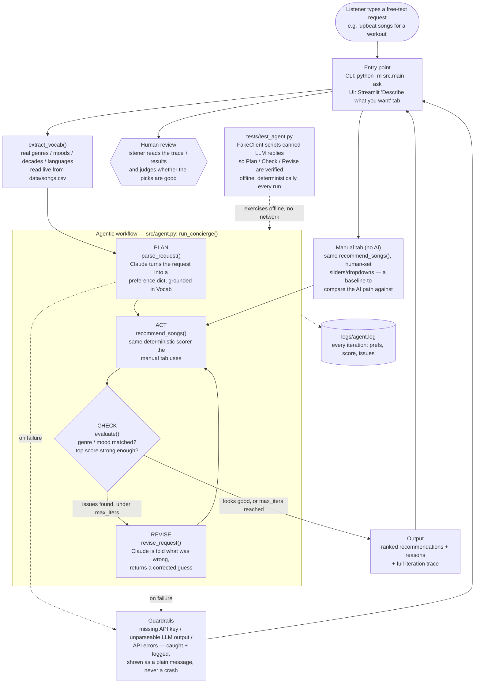

# System Diagram — AI Taste Concierge

This diagram covers the agentic workflow added in `src/agent.py` and how it's
wired into the rest of the app (`src/main.py`, `app.py`, `src/recommender.py`).

## Main components

- **Entry point** (`CLI` / `UI`) — `python -m src.main --ask` and the
  Streamlit "Describe what you want" tab. Both call the same
  `agent.run_concierge()`.
- **Vocab extractor** — reads the real genres/moods/decades/languages out of
  `data/songs.csv` so the agent can only ground its guesses in things the
  catalog actually has.
- **Agent (Plan → Act → Check → Revise)** — the core loop:
  - *Plan* (`parse_request`): Claude turns free text into a structured
    preference dict.
  - *Act* (`recommend_songs`): the same deterministic scorer the manual tab
    uses — this is the "retriever/ranker" component, unchanged by the AI
    layer.
  - *Check* (`evaluate`): a self-check that flags weak or unmatched results.
  - *Revise* (`revise_request`): asks Claude to correct its guess when
    `Check` finds a problem, then loops back to *Act* (bounded by
    `max_iters`).
- **Guardrails** — missing API key, bad/unparseable LLM output, and API
  errors are all caught, logged, and surfaced as a plain message instead of
  a crash.
- **Logs** — every iteration (prefs tried, score, issues) is written to
  `logs/agent.log`.
- **Human / testing checkpoints**:
  - The **listener** reads the iteration trace and final picks in the
    CLI/UI and judges whether they're actually good — the loop stops at
    `max_iters` specifically so a human always gets to see the result and
    decide, rather than the agent silently retrying forever.
  - The **manual tab** runs the identical scorer with human-set
    sliders/dropdowns and no AI step, giving a non-AI baseline a person can
    compare the AI path's picks against.
  - **`tests/test_agent.py`** scripts a `FakeClient` with canned LLM replies
    so `Plan`/`Check`/`Revise` are verified automatically, offline, on
    every test run — no live API call required to catch a regression.

## Data flow (input → process → output)

Free-text request in → agent plans structured preferences, grounded in the
real catalog vocabulary → the existing deterministic scorer ranks every
song against those preferences → the agent checks its own ranking and
revises/retries if it looks weak → ranked songs + plain-language reasons +
a full iteration trace come out, shown to the listener and logged to disk.

## Diagram

